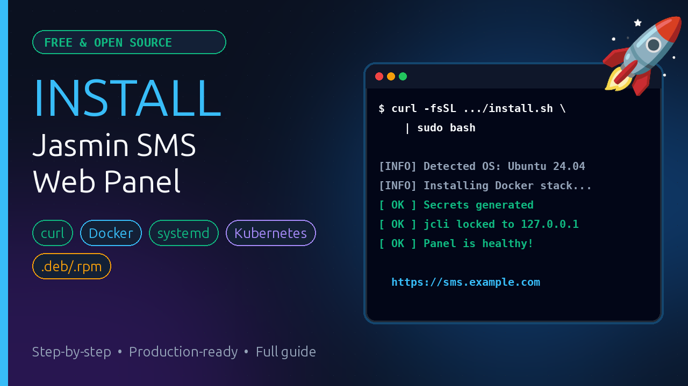
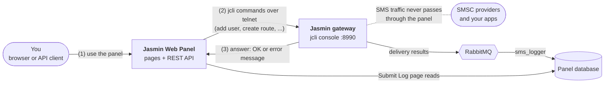

<div align="center">

# Jasmin Web Panel

**The open-source control center for [Jasmin SMS Gateway](https://github.com/jookies/jasmin).**<br>
Manage users, connectors, routes and message logs from a clean web UI or a REST API. No more jcli by hand.

[](https://github.com/101t/jasmin-web-panel/actions/workflows/ci.yml)
[](https://hub.docker.com/r/tarekaec/jasmin_web_panel)
[](https://hub.docker.com/r/tarekaec/jasmin_web_panel)
[](https://www.python.org/downloads/)
[](LICENSE)
[](https://t.me/jasminwebpanel)

[**Documentation**](https://about.supernovasoft.com/jasmin-web-panel/) ·
[**Video tutorial**](https://about.supernovasoft.com/jasmin-web-panel/video-tutorial/) ·
[**Quick start**](#-quick-start) ·
[**Community**](https://t.me/jasminwebpanel)

<a href="https://about.supernovasoft.com/jasmin-web-panel/video-tutorial/">
  
</a>

</div>

---

## ✨ Why Jasmin Web Panel

Jasmin is a powerful SMS gateway, but it is configured through a telnet console. Jasmin Web Panel puts every one of
those operations behind a fast, safe interface, so your team can run the gateway without memorizing jcli.

| | |
|---|---|
| 👥 **Users & groups**<br>Every `mt_messaging_cred` authorization, value filter and quota. | 📡 **Connectors**<br>Create, start, stop and monitor SMPP and HTTP client connectors. |
| 🔀 **Routing**<br>MO and MT routes, including round-robin and failover across connectors. | 🧩 **Filters**<br>Every Jasmin filter type, with hints on where each one can be used. |
| 📊 **Submit Log**<br>Status, cost and DLR per message. Search, filter, export to CSV or Excel. | 💰 **Billing & quotas**<br>Per-user balance, SMS count and throughput; per-route rates. |
| 🔌 **REST API**<br>Automate everything the UI does, from scripts or your own platform. | ✉️ **Send SMS**<br>Test over HTTP or SMPP, including long multipart messages. |
| 📈 **Dashboard**<br>Gateway health and message timelines at a glance. | 🔒 **Secure by default**<br>Encrypted secrets, masked passwords, staff-only API, jcli kept private. |

## 🚀 Quick start

**One command on any fresh Linux server** (Ubuntu, Debian, Rocky, AlmaLinux, RHEL, Fedora):

```bash
curl -fsSL https://raw.githubusercontent.com/101t/jasmin-web-panel/master/scripts/install.sh | sudo bash
```

The wizard asks two questions (Docker or native, and your domain), generates strong secrets, and keeps jcli on
`127.0.0.1`. Prefer to read it first? Download it with `-o install.sh` and review it before running.

**Or the full stack with Docker Compose** (panel, Jasmin, PostgreSQL, Redis, RabbitMQ and the log collector):

```bash
git clone https://github.com/101t/jasmin-web-panel.git && cd jasmin-web-panel
cp sample.env .env          # set SECRET_KEY and FIELD_ENCRYPTION_KEY, change the default passwords
docker compose up -d
```

Open **http://localhost:8999** and sign in with `admin` / `secret`, then **change the password right away**.

## 📦 Deploy it your way

| Method | Best for | Guide |
|--------|----------|-------|
| **One-line installer** | Any fresh Linux server, cloud-init, CI | `install.sh --help` |
| **Docker Compose** | A complete SMS stack on one host | [Docker](https://about.supernovasoft.com/jasmin-web-panel/deployment/docker/) |
| **Docker image** | Panel only, next to an existing Jasmin | [`tarekaec/jasmin_web_panel`](https://hub.docker.com/r/tarekaec/jasmin_web_panel) (amd64 + arm64) |
| **systemd + Nginx** | Classic VMs and bare metal, with Let's Encrypt | [Systemd & Nginx](https://about.supernovasoft.com/jasmin-web-panel/deployment/systemd-nginx/) |
| **Kubernetes** | HA clusters and GitOps (Kustomize in [`deploy/kubernetes`](deploy/kubernetes)) | [Kubernetes](https://about.supernovasoft.com/jasmin-web-panel/deployment/kubernetes/) |
| **.deb / .rpm** | Fleets managed with Ansible, Puppet or Salt | [GitHub Releases](https://github.com/101t/jasmin-web-panel/releases) |

📺 Every method is shown step by step in the
**[installation video](https://about.supernovasoft.com/jasmin-web-panel/video-tutorial/)**, from the first command
to your first delivered SMS.

## 🧭 How it works



Every action becomes the same jcli command an administrator would type, followed by `persist`, so changes survive
restarts. The panel only **manages** the gateway: SMS traffic stays inside Jasmin and never passes through the
panel, so it adds no latency to delivery.

## 🔌 REST API in 10 seconds

```bash
curl -u admin:PASSWORD -H 'Content-Type: application/json' \
     -d '{"type": "DefaultRoute", "smppconnectors": ["carrier1"], "rate": "0.01"}' \
     https://sms.example.com/api/mtrouter/
```

Groups, users, filters, SMPP/HTTP connectors, MO/MT routes and a health check, all behind staff-only
authentication. See the [REST API reference](https://about.supernovasoft.com/jasmin-web-panel/features/rest-api/).

## 🛡️ Production checklist

- `DEBUG=False`, a long random `SECRET_KEY` and a separate `FIELD_ENCRYPTION_KEY`
- `ALLOWED_HOSTS` set to your domain; behind TLS, `HTTPS_ONLY=True` and `CSRF_TRUSTED_ORIGINS`
- **Never expose jcli (port 8990) to the internet.** Keep it on localhost, a private network or a VPN
- Change the default `admin` and RabbitMQ/database passwords, and keep the panel up to date

Every variable is described in the [configuration guide](https://about.supernovasoft.com/jasmin-web-panel/getting-started/configuration/).
Stuck? Check [Troubleshooting](https://about.supernovasoft.com/jasmin-web-panel/troubleshooting/).

## 📚 Documentation

| Guide | What you'll find |
|-------|------------------|
| [Installation](https://about.supernovasoft.com/jasmin-web-panel/getting-started/installation/) · [Configuration](https://about.supernovasoft.com/jasmin-web-panel/getting-started/configuration/) | Local setup, every environment variable |
| [Gateway management](https://about.supernovasoft.com/jasmin-web-panel/features/gateway-management/) · [Submit Log](https://about.supernovasoft.com/jasmin-web-panel/features/submit-log/) | Users, connectors, routes, message tracking |
| [REST API](https://about.supernovasoft.com/jasmin-web-panel/features/rest-api/) · [Troubleshooting](https://about.supernovasoft.com/jasmin-web-panel/troubleshooting/) | Automation, common errors and fixes |

## 🤝 Community & contributing

- 💬 **Questions and ideas:** [Telegram community](https://t.me/jasminwebpanel)
- 🐛 **Bugs and feature requests:** [GitHub Issues](https://github.com/101t/jasmin-web-panel/issues)
- 🔐 **Security reports:** please follow the [Security Policy](SECURITY.md), not public issues

Contributions are very welcome. Read the [Contributing Guide](CONTRIBUTING.md) and the
[Code of Conduct](CODE_OF_CONDUCT.md), then open a pull request. If the panel saves you time,
**⭐ star the repository**: it helps other Jasmin users find it.

## 📄 License

Released under the [MIT License](LICENSE). Free for personal and commercial use.

---

<div align="center">

### 🏢 Need the enterprise edition?

**[SMPP Forge](https://smppforge.com)** is the full-featured enterprise SMS platform,<br>
with professional support for businesses that run messaging at scale.

[smppforge.com](https://smppforge.com) · [info@smppforge.com](mailto:info@smppforge.com)

</div>
