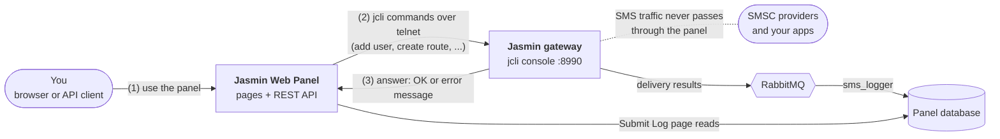

# Jasmin Web Panel

**Jasmin Web Panel** is a full-featured, modern web interface for the open-source [Jasmin SMS Gateway](https://jasminsms.com/). It provides complete control over your SMS infrastructure with an intuitive UI, advanced logging, and user management.

## Video Overview

Watch the quick-start walkthrough to see Jasmin Web Panel in action:

<div style="position: relative; padding-bottom: 56.25%; height: 0; overflow: hidden; max-width: 100%;">
  <iframe
    src="https://www.youtube.com/embed/z-BFJzWtq1M"
    title="Jasmin Web Panel – Quick Start"
    frameborder="0"
    allow="accelerometer; autoplay; clipboard-write; encrypted-media; gyroscope; picture-in-picture"
    allowfullscreen
    style="position: absolute; top: 0; left: 0; width: 100%; height: 100%;">
  </iframe>
</div>

> Prefer a direct link? Watch on YouTube: <https://youtu.be/z-BFJzWtq1M>

## Key Features

- **User Management**: Create and manage Jasmin groups and users, with every `mt_messaging_cred` authorization, value filter and quota.
- **Routing Control**: Manage MO (Mobile Originated) and MT (Mobile Terminated) routes, including round-robin and failover routes over several connectors.
- **Filter Management**: Create every Jasmin filter type; the panel shows which ones can be used on MO and MT routes.
- **Connector Management**: Configure, start, stop and monitor SMPP client connectors and HTTP client connectors.
- **Real-time Logging**: Track message status with the integrated [Submit Log](features/submit-log.md) viewer and export it to CSV or Excel.
- **Billing & Quota**: Set per-user balance, SMS count and throughput quotas, and per-route rates for MT billing.
- **REST API**: Manage the gateway from scripts with the [REST API](features/rest-api.md).
- **Modern Dashboard**: Responsive interface with gateway health and message statistics.

## Quick Start

Get the full stack (panel, Jasmin, PostgreSQL, Redis, RabbitMQ) running with Docker Compose:

```bash
git clone https://github.com/101t/jasmin-web-panel.git
cd jasmin-web-panel
cp sample.env .env      # set SECRET_KEY, change the default passwords for production
docker compose up -d
```

Open <http://localhost:8999> and sign in with `admin` / `secret`, then change the password.

Already running Jasmin? Run only the panel and point it at your gateway's jcli port:

```bash
docker run -d \
  --name jasmin-web \
  -p 8999:8000 \
  --env-file .env \
  tarekaec/jasmin_web_panel:3.1.0
```

See the [Installation Guide](getting-started/installation.md) for full setup options including [Docker](deployment/docker.md) and [Systemd & Nginx](deployment/systemd-nginx.md).

## Architecture



**How the panel and the gateway talk:**

1. You use the panel in the browser (or call its REST API).
2. For every action (add a user, create a route, start a connector) the panel opens a telnet session to Jasmin's
   **jcli** console on port `8990` and types the same commands an administrator would, then runs `persist` so the
   change survives a restart.
3. Jasmin answers; the panel shows the result, or Jasmin's own error message if the command was refused.

The panel only *manages* the gateway. Your SMS traffic flows through Jasmin's SMPP server and HTTP API and never
passes through the panel. For the Submit Log, Jasmin publishes delivery results to RabbitMQ and the `sms_logger`
service stores them in the panel's database, which the **[Submit Log](features/submit-log.md)** page reads.

- **Frontend**: Server-rendered Django templates with Bootstrap and jQuery
- **Backend**: Django (Python 3.11+) talking to jcli; the REST API uses the same code path
- **Task Queue**: Celery with Redis (exports run in the background)
- **Database**: PostgreSQL (recommended), MySQL, or SQLite for development; it holds panel accounts, the activity log and submit logs
- **Gateway**: Jasmin SMS Gateway (separate service). RabbitMQ is used by Jasmin and by the submit-log consumer, not by the panel itself
