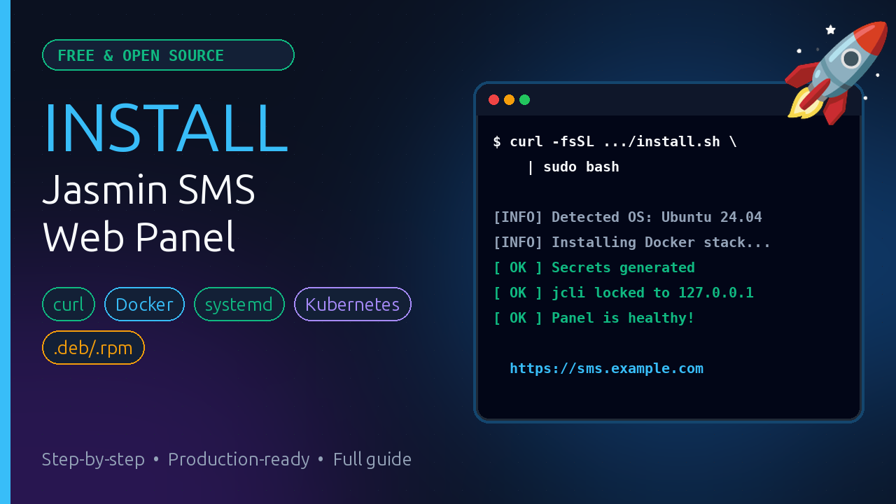

# Installation Video Tutorial

A complete, narrated walkthrough: every installation method, the first configuration of the gateway, the Submit
Log, and the production security checklist. Each chapter stands on its own, so jump straight to the one you need.

<!--
  After uploading to YouTube, replace the link below with the embed (VIDEO_ID = the id after "watch?v="):

  

    <iframe src="https://www.youtube.com/embed/Jxyh9y7AzcY" title="Jasmin Web Panel – Installation Guide"
      frameborder="0" allow="accelerometer; autoplay; clipboard-write; encrypted-media; gyroscope; picture-in-picture"
      allowfullscreen style="position: absolute; top: 0; left: 0; width: 100%; height: 100%;"></iframe>
  

-->

## Chapters

<!-- chapters:start -->
| Time | Chapter |
|------|---------|
| `00:00` | Introduction |
| `00:42` | Overview — How it works & prerequisites |
| `02:23` | Installer — One-line curl installer |
| `04:30` | Docker — Docker Compose full stack |
| `06:21` | Systemd — Native systemd + Nginx + SSL |
| `08:44` | Kubernetes — Kustomize, Ingress & scaling |
| `10:24` | Packages — Native .deb & .rpm packages |
| `11:48` | First Run — Users, connectors, routes & first SMS |
| `14:03` | Logs — Submit Log, dashboard & troubleshooting |
| `15:36` | Security — Production hardening checklist |
| `16:41` | Wrap-up & resources |

Total length: **17:28**
<!-- chapters:end -->

## Follow along in the docs

| Chapter | Written guide |
|---------|---------------|
| One-line installer, systemd + Nginx, packages | [Systemd & Nginx](deployment/systemd-nginx.md) |
| Docker Compose | [Docker](deployment/docker.md) |
| Kubernetes | [Kubernetes](deployment/kubernetes.md) |
| Users, connectors, routes | [Gateway Management](features/gateway-management.md) · [REST API](features/rest-api.md) |
| Submit Log & monitoring | [Submit Log](features/submit-log.md) · [Troubleshooting](troubleshooting.md) |
| Production security | [Configuration](getting-started/configuration.md) |

English subtitles ship with the video. The video is generated from
[`scripts/generate_install_video.py`](https://github.com/101t/jasmin-web-panel/blob/master/scripts/generate_install_video.py),
so it can be re-rendered whenever the install steps change.
